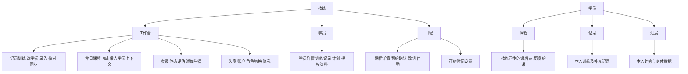

# TrainBuddy 私教工作工具体验重构方案

第一轮研究与设计交付。日期：2026年11月3日。代码基线：`a63d1b6`，当前分支 `feat/coach-profile-navigation`。本轮不实施页面或业务改造。

## 1 设计结论与边界

核心闭环定为：选定学员 → 录入本次训练 → 核对动作及每组数据 → 确认同步 → 学员查看 → 教练调整下一次计划。产品首先缩短私教课后的重复记录，不再让一般健康打卡、AI 工具和统计摘要主导首屏。

教练仅设三个主要导航：**工作台、学员、日程**。账户和角色切换由工作台右上角头像进入，个人页保留为二级页面。学员建议三个主要导航：**课程、记录、进展**，不复用教练工作台；“课程”中承载当前教练反馈及约课入口。

不新增接口、字段、AI Prompt 或识别供应商，不改变训练完成、计划发布、授权和预约确认规则。本轮提出的状态机、数据暂存及交互编排均为后续前端实现建议，不能当作已实现功能。

### 证据来源及解释

直接读取了 app.json 的 26 个注册路由、导航组件及相关 WXML/JS/WXSS；提取结果见 `pages.json`。重点复核 home、record、workout、plan-edit、students、student-profile、booking、growth、profile、ai 和 speechComposer。参考了桌面《需求记录.md》、docs/FRONTEND-DESIGN.md、docs/API-voice.md、docs/COACH-NAVIGATION.md 及现有交互组件。

桌面需求记录为早期愿景，仍含会员、广义健康记录和未来身材获客设想；本次“私教轻量工作工具”定位优先于早期功能铺陈。早期“约30秒”指口述时长，不是已经验证的全流程耗时或强制性能承诺。FRONTEND-DESIGN 中有与当前导航、Logo 和配色相矛盾的历史章节，本方案以当前代码为现状依据。

本轮是源码体验审查，没有新增真机观察、用户访谈、录音准确率或耗时实测。下面的风险属于静态证据与设计推断，未将其写成已复现的运行事故。

## 2 全部页面盘点及新旧映射

“保留二级”表示继续使用现有路由，不新增底部导航；“收拢”表示统一入口或复用视图，不表示删除历史数据或接口。Guard 列来自页面入口，实际资源访问仍由服务端判定。

| 现有 pages 路由 | 当前作用与入口检查 | 目标归属及处理 |
|---|---|---|
| login/index | 登录与演示账号，无登录前置 | 保留公共入口；演示与正式登录分开标明 |
| home/index | 教练/学员共用首页，requireLogin | 教练工作台；学员在同一路由按角色展示课程概览，避免共享工作台布局 |
| booking/index | 双角色预约/排课，requireLogin | 教练“日程”主导航；学员从课程进入可约时间与预约列表 |
| booking-detail/index | 预约状态、确认、改期、出勤，requireLogin | 课程详情二级；动作按角色和实际状态呈现 |
| schedule-rules/index | 周规则与例外，requireCoachRole | 日程右上“可约时间设置”；移除生产界面的固定演示快捷操作 |
| record/index | 教练课后表、语音、合并、逐组编辑，requireCoachRole | 工作台主操作“记录训练”目的页；改造同一路由的录入和确认状态 |
| students/index | 学员搜索、名单及诊断入口，requireCoachRole | 教练“学员”主导航；诊断从常规用户界面隐藏 |
| student-profile/index | 教练查看学员训练及共享健康资料，requireCoachRole | 学员详情二级；训练记录/计划优先，饮食与身体授权内容折叠 |
| workout/index | 开始及逐组记录自主训练，requireLogin | 学员“记录”主导航；教练通过自己的训练入口按需进入，不代替课后表 |
| plans/index | 计划列表、编辑/开练，requireLogin | 学员记录页“训练计划”；教练经学员详情进入现有有权限的计划流 |
| plan-edit/index | 草稿、组参数、发布，requireLogin及计划权限 | 计划编辑二级；保留版本冲突规则，参数面板减负 |
| exercises/index | 动作列表与筛选，requireLogin | 记录编辑时“添加动作”主要进入点；其他学习入口二级 |
| exercise-detail/index | 动作说明、收藏、加入计划，requireLogin | 动作库详情二级；保留既有加入个人草稿的语义，不伪装可加入任意学员计划 |
| diary/index | 饮食/饮水/恢复与共享手风琴，requireLogin | 学员记录页“补充记录”；教练通过获授权的学员详情查看，不作主导航 |
| coach/index | 学员与绑定教练的课后反馈、饮食点评和约课，requireLogin | 学员“课程”的教练协作详情；保留同步记录的私人字段隔离 |
| growth/index | 本人统计、日历、记录及工具入口，requireLogin | 学员“进展”；教练取消主导航，工具迁入工作台次级区，自己的进展由账户进入 |
| body-data/index | 本人身体图、指标、图表与日历，requireLogin | 学员进展→身体数据二级；不把本人数据默认赋给教练所选学员 |
| body-metric/index | 指标详情，requireLogin | 保留为身体数据下的指标详情，不重复入口 |
| body-record/index | 身体测量录入，requireLogin | 从身体数据/指标详情打开；优先轻量面板呈现，第一批不删路由 |
| body-history/index | 身体测量历史，requireLogin | 身体数据→历史二级，原值和时间保留 |
| ai/index | 饮食/体态/目标图三工具及咨询，requireLogin | 改为上下文工具详情，沿用 tool 查询参数直达；取消一级轮播“工具商城”定位 |
| food-photo/index | 拍照饮食及确认记录，requireLogin | 学员补充记录→拍照饮食；不放教练工作台主位 |
| profile/index | 账号、身份切换、邀请、隐私，requireLogin | 双端头像→账户二级；继续作为唯一主要角色切换入口 |
| bind/index | 邀请码绑定教练，requireLogin | 学员课程空状态→绑定教练；邀请必须对方确认，不能静默创建关系 |
| privacy/index | 授权及撤回，requireLogin | 账户与内容共享时的上下文入口 |
| friends/index | 朋友近七天训练及点评，requireLogin | 从主流程移出，暂收至账户的更多工具，保留现有关系能力；是否正式保留待用户行为验证 |

当前路由分散但没有必要为了改产品定位整体重写。先收入口与信息层级，再评估身体指标的多个路由是否需要呈现合并。不能把“界面放入面板”误当成 API 或数据实体合并。

## 3 当前导航与目标架构

当前教练： 首页 / 排课 / 学员 / 成长 / 个人；学员： 首页 / 约课 / 训练 / 成长 / 个人。导航组件是自定义 WXML，切页使用 redirectTo，而不是 app.json 的原生 tabBar。上一轮已移除页面角色框，个人已正确指向 profile，不能重复把这些列为尚未解决的问题。



### 教练工作台首屏

顺序：日期与头像 → **记录训练** → **今日课程** → 两个次级入口。主按钮占首屏唯一强调位；下方写当前选中学员或“先选择学员”，最近学员以真实上下文选择，不根据缓存悄悄替用户决定记录对象。

今日课程每行只展示时间、学员、课程状态及“记录”按钮；需接受/拒绝的预约集中为一行“待确认预约 N”，点击去日程。课程点击进入既有 booking-detail，“记录”带入既有绑定学员 ID；不新增预约和训练实体的关联字段，不推断两者已经强关联。

体态评估、添加学员以小尺寸图标+文字并列放在课程下；工作台不展示绑定总人数、完成率、口号、大面积品牌卡、朋友动态和营养卡片。无课程时主录入仍可使用，但必须选择有效绑定学员。

### 学员与日程

学员主屏只有搜索、名单及添加入口。每行：姓名、最近训练日期（数据存在时）、进入详情。不制造流失风险分数或无依据的进步标签。详情默认训练记录，其次计划，授权资料按需展开。

日程默认今天；短日期条、当天课程时间线、待处理预约。周视图与可约时间设置放工具栏，不再做首页重复日历。预约仍以服务端 pending/confirmed 为准，提交请求不能显示成确认成功。

### 学员端

课程首屏显示下次已确认课程，待确认单独标注；其次显示最近教练同步训练表和建议，没有课程时去约课。记录以本人训练和课后表历史为核心，明确“自主训练”“教练记录”，不展示教练写课后表或管理他人的入口。进展保留训练历史、力量/容量趋势和身体记录，数据不足时不画假变化；只使用现有 API 能提供的真实字段，暂无的数据维度不凭前端计算假指标。

## 4 当前体验问题与可执行方案

| 优先级及证据 | 当前问题及影响 | 前端改造方案与验收 |
|---|---|---|
| P1 home/index.wxml 教练分支 | 口号大卡+三个统计，主 CTA 去排课；课后记录在两按钮中是次级 | 主按钮改记录训练，今日课程紧随其后；无滚动可找到录入；统计数字只有需要处理的预约保留 |
| P1 home 的 goCourse/goRecordFor；record onShow | 从课程、学员、通用记录进入时上下文入口不同；record 会使用 activeSubject 或第一位学员 | 显式姓名、日期、草稿状态始终可见；首次通用入口先选人，课程和档案入口验证绑定后带入，不自动开始录音 |
| P1 record/index.wxml:67/174 | 实际 catchtouchstart/end 按住录音，输入框却提示“点右侧麦克风”，两处录音无统一状态面板 | 一次点击开始、一次点击结束，取消长按语义；统一录音条，选择“训练内容/公开建议”上下文 |
| P1 record/index.js:225 | 切学员只以 syncing 拦截，随后清空文字及候选；录音/识别中没有同等离开保护 | 活跃录音/处理/未保存编辑时明确阻断切换或保留当前草稿后切换；迟到结果按账号+学员+session+任务 ID 校验 |
| P1 record/index.js:433/470 | 组参数 blur 即写 API；每次备注 input 都 patchMeta，多个响应可竞争覆盖展示，失败无持续就地反馈 | 前端集中待保存队列、字段草稿和保存状态；重试保留值，提交前等待写队列清空；此处是静态风险，不声称本轮已复现数据覆盖 |
| P1 record/index.js:481 起 | 同步前会自动把所有 pending 组设为 done；用户看见的按钮只写“确认并同步” | 不擅改此既有规则。确认页逐项列出将被标完成的组，告知本次同步的影响；如要取消自动完成，另行作为业务规则变更批准 |
| P2 record/index.wxml:81/100/105 | “解析为候选”“结构化候选”“替换组”要求教练理解实现术语；默认可见三个合并模式 | 主文案“整理训练内容”“核对识别结果”“确认加入训练表”；高级合并折叠为“处理重复动作”，仍保留三种原有语义和破坏性确认 |
| P2 record/index.wxml:119–121 | 缺失项补填只显式提供组/次/名称；重量口径和未知值在结果里以技术标签表示 | 核对面板清晰标出动作、组、次数、重量、单侧/总重/未知；不推断未知值，不新增结构字段，按既有 segmentPatches 支持范围做校验 |
| P2 record/index.wxml:152；record/index.wxss | 110rpx 小输入和满屏组行，三种控件混排；品牌图标反复占动作行空间 | 动作摘要用紧凑表格，每行组序号/重量/次数/状态；点击行展开已存在数值组件，44px 触控目标，去重复 Logo |
| P2 record/index.wxml:32/34 | rev、ASR provider、英文状态直接进入常规用户任务 | 面向用户显示“草稿/已同步/识别处理中”；版本号、供应商和原始错误码移诊断详情，错误日志保留 |
| P2 speechComposer.js:104/124 | 真实回填按28ms逐字播放；mock 模拟出字可能被误当作实时识别 | 已完成结果直接展示；仅真实 partial 标“实时转写”，演示醒目标记；不为了视觉效果延迟确认 |
| P2 record/index.js:249 | 选择学员后进入 createCoachDraftSession，页面重进可能又触发；是否复用由现有实现决定 | 不新造持久草稿 API；优先恢复现有会话，明确展示“新记录/继续草稿”，上下文 ID 不串档 |
| P2 tokens.wxss 与 interaction.wxss | 同名 ix token 在两个作用域定义；部分逐组容器使用999rpx胶囊，信息密度不稳定 | 单一语义 token，保留兼容别名；大圆角只用于小标签，数据表和录入区使用较小圆角 |

训练计划编辑 plan-edit 已有参数面板、动作与组复制、上下移动和草稿冲突提示，应复用。不要为了统一把它退化成新的大表单。将草稿版本、说明和高级参数折叠，标题、动作、逐组参数、保存发布按顺序呈现；拖拽与按钮排序都保留。

## 5 语音录入组件设计

### 视觉及任务顺序

记录页首部固定“学员姓名 · 本次日期 · 草稿状态”。接着是主录入区，默认语音，文字为同位切换，切换不清空内容。录音状态条包含状态文字、累计有效录音时间、暂停/继续与结束按钮；不把波形当成唯一反馈，不用动画暗示录音已经成功开始。

```text
选学员       林野的学员  王同学        更换
记录训练     11月3日   尚未同步

  [  点击开始录音  ]           改用文字
  或
  ● 正在录音  00:18      [暂停] [结束]
  已暂停      00:18      [继续] [结束]

结束 → 正在整理 → 核对识别结果
杠铃卧推     3组    50 kg × 5次    [修改]
哑铃划船     缺重量口径            [补充]

[确认加入训练表] → 核对每组 → [确认并同步学员]
```

结果确认不是又一次录音；“确认加入”调用原 merge，不自动等同于最终同步。公开建议与私人备注分别标注可见范围；私人备注默认折叠。两种录音输入共享一个前端控制器，禁止同时占用全局录音器，不能各自抢占回调。

### 状态机及按钮规则

| 状态 | 主操作/次操作 | 离开与恢复 |
|---|---|---|
| idle 待录入 | 点击开始 / 文字 | 未选学员先选择；不自动触发麦克风 |
| requesting 请求录音能力 | “正在启动”禁连点 | 拒绝/设备失败进入可恢复错误，不进入 recording |
| recording 实际录音已开始 | 结束 / 暂停 | 计时以实际回调为准；不得切换学员；来电、锁屏、后台中断标为 interrupted |
| paused 已确认暂停 | 继续 / 结束 | 有效时长停止累计；超时需停止并保留已录片段，不后台无限录制 |
| stopping 等待录音结束 | 等待 / 不再发 stop | onStop 后才处理文件，防双击重复任务 |
| processing 转写或结构化 | 等待 / 可保留结果后退出 | 有文字就保留；不自动加入训练；不提供当前协议不支持的假“取消服务端任务” |
| reviewing 结果待核对 | 确认加入 / 修改或补充录音 | 缺失、冲突逐项标出；未确认项不按默认值填满 |
| saving 保存合并中 | 禁连点 | 成功才回到训练表；失败保留候选、人工修改和请求标识 |
| error/interrupted | 重试或继续 / 手填 | 保留已有文字；音频是否能重试依据本地文件实际存在，不能承诺永久恢复录音 |

### 暂停能力的真实边界

当前 createSpeechComposer 只导出 start/stop/destroy，WechatSI 与 recorder 两通道不同。不能只增加一个“暂停”按钮然后用计时器假停。

优先方案：在**前端录音控制适配层**对支持的原生 RecorderManager 使用 pause/resume，并监听确认回调；结束仍用现有临时文件与 voiceApi.createTask，保留格式、采样率、base_revision、合并模式等协议。此处允许调整前端录音控制和展示，不调整识别服务或音频处理算法。

WechatSI 的当前封装没有暴露可靠的暂停能力，必须先核实插件版本与能力。不能把原生录音器的能力直接套给插件。若无法可靠暂停且不能改识别通道，降级显示“结束本段 / 继续补录”，串行处理片段并在前端汇总文字供核对，明确这是分段录入，不宣称同一音频暂停。每段会产生一次现有任务请求，应展示处理状态并避免无意重复计费。不要为满足视觉稿擅自更换供应商。

现有封装开始时就触发前端 onStart，原生真实开始回调未作为状态门；后续要将“请求开始”与“已开始”分开。单段当前配置60秒，界面按当前真实限制显示剩余时间；临近上限提示，不能另起一个不匹配的展示时长。退出时停录、解绑回调及清理定时器，并用任务归属判断丢弃迟到 UI 更新。

## 6 共用组件与 Design Tokens 初稿

先保留当前暖白绿品牌，不启动第二次换肤。重点缩减容器数量、恢复数据密度。只做必要轻反馈，动效不计入业务成功条件。

| 语义 Token | 建议值/规则 | 当前兼容方式 |
|---|---|---|
| color.background / surface | #FAFBF7 / #FFFFFF | 复用 paper / surface |
| color.text.primary / secondary | #25352C / #6E7C72 | 复用 ink / muted；关键小字需补实际对比度检查，不默认都合格 |
| color.action / line | #28744E / #E0E7DC | accent / line 单一来源 |
| color.recording / error | #B42332 | 独立危险/录音色，不改写成绿色；文字同时说明状态 |
| space | 4/8/12/16/24/32 px | 常规页面边距16；数据区行距按触控调整 |
| radius | 8px 输入，12px面板，999px仅标签 | 取消逐组数据容器的大胶囊 |
| typography | 标题20/24，正文14/16，辅助12/13，组数值24/28 px | 系统字体，数字等宽；不下载字体包 |
| touch | 常用目标至少44×44 CSS px 等效 | 使用rpx布局时按实际屏宽校验；小文字不等于小触控区域 |
| motion | 按压100ms，状态180ms，面板240ms | transform/opacity；减少动画时0–80ms，不关掉状态文字 |

| 组件 | 内容和状态 | 原代码复用点 |
|---|---|---|
| WorkbenchRecordEntry | 学员上下文、开始或继续草稿 | home→record 及已有权限预检 |
| StudentContextPicker | 搜索已绑定学员、最近使用、明确选中 | students / record，不新增学员创建 API |
| VoiceCapture | 单控制器、开始/结束、暂停能力检测、计时与中断 | speechComposer hooks，只做前端控制 |
| RecognitionReview | 原话折叠、动作摘要、缺失项、冲突及确认 | segments / segmentPatches / merge / undo |
| TrainingSetRow | 重量/次数/组完成，局部保存失败，复用上一组 | training-number-control 与现有 updateActualSet |
| RecordFooter | 本地未保存/保存中/服务器草稿/已同步，唯一主 CTA | patchMeta / finalize，明确区分本地和远端状态 |
| CourseRow | 时间、学员、实际状态、记录入口 | booking 数据及详情动作 |
| ContextToolPanel | 正面/侧面→分析状态→已有结果 | ai?tool=posture，无新增任务协议 |
| AsyncState | 首载、空数据、部分错误、离线、会话过期 | 合并当前 ui-state；失败不显示成“暂无” |

### 空状态和加载状态

没有学员：解释需要对方接受邀请，主操作“邀请学员”，不展示模拟名单。无今日课：显示“今天暂无课程”，保留独立记录入口。无训练：空表只保留语音和文字两个录入入口。未授权麦克风：说明并提供系统授权入口及手填替代，不循环弹授权。识别未配置：明确“服务未配置”，演示只能主动选择。单个区块失败：该区块可重试，其余已加载内容不清空。登录过期：给重新登录入口，保留合法本地草稿，不让所有模块一串401各自弹窗。加载中不抢先渲染“无学员/无课程”，不使用固定延时假进度。

## 7 体态评估与辅助获客的入口

工作台次级“体态评估”直接进入已有 ai 页的 posture 模式，可先用现有路由呈现工具内容；确认体验后才把上传/结果收拢为组件，暂不创建新 assessment 页面。学员详情可以有同一入口，但带入姓名只表示上下文，不代表已取得其照片访问权或能把评估结果写入学员档案。

当前 AI 任务及媒体存在所有者约束，必须核对教练代学员上传是否已被现有接口允许。若没有，不在前端伪造 ownerId/subjectId；首版保留本人体验或引导学员上传并授权，不能为了“自然入口”改变数据归属。展示的是体态观察和待教练复核的信息，不作医疗诊断。

“添加学员”在当前接口下实际是生成邀请码→分享→学员查看教练并接受→列表刷新，不是教练填姓名立即创建正式账户。可以把邀请码内容放进轻量面板，但不可新增没有服务端身份的“学员”。首次注册为无绑定教练账号时，应先显示角色授权状态，再提供符合权限的邀请流程。

阶段身材图作为体态工具中的次级“训练目标预览”，不放首页主位、不承诺真实改变、不自动发布获客素材。饮食识别留在学员记录；朋友动态和独立 AI 工具导航不进入三导航首版。

## 8 小程序技术适配评估

当前为微信原生 WXML/WXSS/JS、自定义底部导航和原生输入，没有必要引入 React、DOM 或大动画依赖。样式 transition、简单关键帧、原生 animation 可覆盖按压、展开、状态切换；底部面板需处理键盘、安全区、滚动穿透和返回手势，不把页面导航做成全屏弹层堆叠。

原生录音器的暂停/继续由腾讯文档明确列出，官方类型仓库也可用于 API 对照，但这不等于当前 speechComposer/WechatSI 已支持。官方微信开发者文档直连本次无法获取，技术核对另参考腾讯云官方说明与微信官方 api-typings；实施时仍须以项目所用基础库和插件版本在 iOS/Android 验证。

建议录音计时每秒更新，真实音量若没有可信输入就用静态状态而非伪造音频频谱；短录音条若采用装饰呼吸效果需减少动画模式，不能称为音量。不要逐字 setData 制造“流式识别”；真实 partial 可适度合并刷新，不丢最终结果。避免 JS 每帧驱动、列表高度动画、复杂共享元素变形及手势拖拽作为唯一操作。

原生三导航可继续使用现有自定义组件；先做草稿恢复和进入/离开生命周期测试，再评估是否改原生 tabBar，不同时改导航技术与录入流程。因为当前 redirectTo 会销毁页面，切导航前必须完成离开保护，不能假定三个页面会自动保留状态。

参考：
- 腾讯云官方录音 API 说明：https://cloud.tencent.com/document/product/1301/109326
- 微信官方类型定义：https://github.com/wechat-miniprogram/api-typings/blob/master/types/wx/lib.wx.api.d.ts
- 微信动画文档入口：https://developers.weixin.qq.com/miniprogram/dev/framework/view/animation.html （本次未能直接读取）

## 9 删除 隐藏 保留的界面内容

**从主界面删除**：教练五导航中的成长与个人标签、首页三统计大卡/口号/重复学员卡、全局角色切换框（上一轮已完成，不重复开发）、重复大 Logo、默认可见的英文任务状态与版本号。个人功能仍从头像进入，不删个人路由。

**从常规界面隐藏或下沉**：朋友窗口、饮水/饮食打卡统计、开发诊断、固定演示排班与默认训练模板、合并替换高级选项、私人备注、大段使用说明、未配置 AI 的主 CTA。已有高级能力保留合规入口；演示/诊断只在明确开发环境或专门诊断入口提供，不能用“隐藏”绕过鉴权。

**必须保留**：课后表语音与文字、逐组不同重量次数、公开建议与私人备注隔离、学员绑定确认和分类授权、预约接受/拒绝/改期及状态、历史记录、计划草稿和发布、失败重试及撤回授权。不删数据、实体或服务端能力。

## 10 分阶段实施及客观验收

| 阶段 | 范围与顺序 | 必须达到的验收及回滚 |
|---|---|---|
| 0 本轮设计 | 固定a63d1b6；完成26页映射、三导航、组件与边界 | 用户确认架构与录入方案后才实施；本轮业务代码零修改 |
| 1 导航与工作台 | 先教练三导航、头像账户、语音主CTA、今日课程；再学员课程/记录/进展 | 26个旧路由入口与授权矩阵核对；任何旧能力不会成为无入口孤岛；一个布局提交可独立回滚 |
| 2 录音控制与结果核对 | 一处录音控制、点击开始/结束、可用通道暂停/恢复、文字替代、结果确认 | 快速连点只一次启动/任务；真实开始回调才计时；暂停计时停止；拒绝/来电/后台/60秒上限均有明确状态；不改ASR请求与Prompt |
| 3 编辑与同步 | 复用数值组件、字段草稿、串行保存状态、退出保护、同步影响摘要 | 最后输入不因点同步丢失；识别等待改重量不被覆盖；学员切换无迟到结果串档；失败可恢复；pending自动完成规则显式确认，不擅自修改 |
| 4 学员和上下文工具 | 学员详情收拢、邀请面板、体态直达、弱化健康和朋友入口 | 真实绑定接受后才出现学员；未授权照片不可读；未配置AI不伪装可用；已同步表及反馈正确到达学员 |
| 5 双端验证 | 自动化→微信模拟器→iOS/Android任务观察 | 开始前记录设备/基础库/供应商配置；30秒仅口述目标；记录全流程耗时、点击数、失败点，修复前后用同一任务对比，不预宣称提升百分比 |

每阶段独立提交；保持既有 API 契约测试通过，补导航、状态机、无障碍标签与乱序请求测试。第一批不用新增图表、CRM分层、消息中心、支付或复杂模板引擎。

### 具体交互验收任务

1. 教练从今日课程点“记录”，看到正确学员；从通用记录入口先明确选人。两种路径均不自动打开麦克风。
2. 口述“卧推三组，第一组50公斤5次、第二组50公斤5次、第三组45公斤5次”，暂停后续录；确认每组不同值，不靠默认值填平。
3. 录音中点击学员切换、底部导航、返回、来电；中断状态准确，文本不串给另一位学员，过期识别回调不改当前页面。
4. 转写后人工改重量，执行合并并重试同一请求；不重复动作，不覆盖人工已确认值。
5. 最后一字段仍聚焦时直接点同步，确认保存队列结束后同步；断网时不显示成功，恢复后只重试必要请求。
6. 同步前确认公开建议、私人备注、pending组完成影响；学员只看到已确认同步的可见内容。
7. 预约待确认不可显示已约成功；批量部分冲突保留每项结果；日程到记录不改变课程业务状态。
8. 无学员、无课程、无记录、登录过期、授权拒绝分别有可执行的唯一主操作。
9. 体态照片进入不增加三层菜单、不绕过所有者权限；真实服务不可用时准确提示，不用mock结果作验收。
10. 大字模式、键盘、单手触控和减少动画下，主操作仍可达，状态仍可理解。

## 11 本轮建议确认的设计基准

建议采用教练“工作台 / 学员 / 日程”、学员“课程 / 记录 / 进展”；录入沿用 record 路由，分为录入、核对、训练表三个任务状态，避免再新增独立页面。教练工作台让“记录一位学员的本次训练”成为第一眼可见的主动作，而不是让用户先理解统计或AI工具。

本文件与 wireframes.svg 为待实施的设计稿，不能作为上线或真机验收结果。确认后按阶段1开始，不执行大规模换肤、不重写业务、不改模型与服务端接口。
